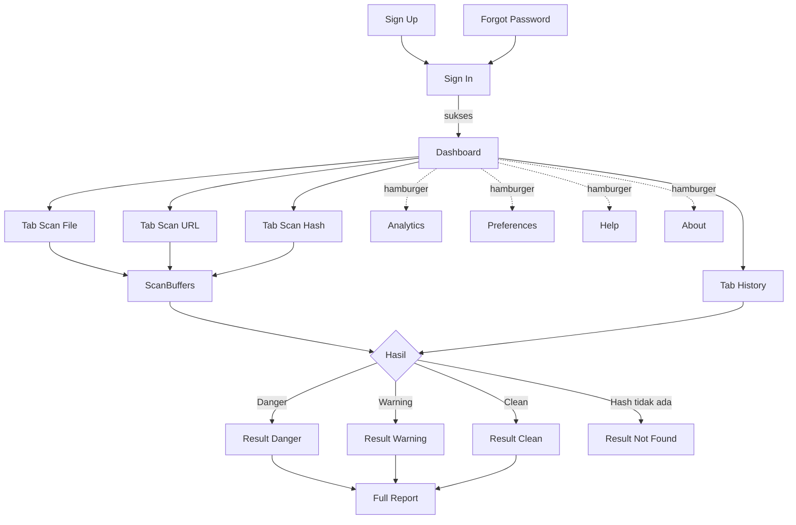

# Product Requirements Document (PRD) — Cyber Claw (v1.1)

| Atribut | Nilai |
|---|---|
| Nama Produk | **Cyber Claw** |
| Jenis | Web-based Virus Scanner (berbasis VirusTotal API v3) |
| Versi Dokumen | 1.1 (MVP) — arsitektur React + Vite (client) & Express (server) |
| Konteks | Proyek PKL, PT Infinite Learning Indonesia |
| Pendekatan Dev | Vibe coding + Generative AI (AI-assisted development) |
| Arsitektur | SPA `client/` (React + Vite + TypeScript) + REST API `server/` (Node.js + Express + TypeScript) |
| Deployment | Frontend: Vercel · Backend: Railway / Render |
| Status | Siap dikembangkan |
| Bahasa UI | Indonesia (default) dan Inggris |

> **Catatan untuk pengembang / AI agent:** Dokumen ini adalah *single source of truth*. Jika ada hal yang tidak tertulis, ambil keputusan paling sederhana yang konsisten dengan dokumen ini, lalu catat asumsinya di `DECISIONS.md`. Jangan menambah fitur di luar bagian **Scope**.

## Riwayat Perubahan

| Versi | Perubahan |
|---|---|
| 1.0 | Draf awal (berbasis Next.js). |
| 1.1 | Stack diganti: **React + Vite + TypeScript** (frontend), **Node.js + Express** (backend), **React Router DOM** (routing). Struktur repo dipisah menjadi `client/` dan `server/`. Endpoint kini berupa **Express Routes**. Variabel lingkungan dipisah per paket. Deployment: **Vercel** (client) dan **Railway/Render** (server). Bagian yang terdampak: 2.1, 5.1, 5.3, 5.5, 6.1–6.2, 7 (ditulis ulang), 8.1, 8.3, 8.5, 9.2–9.3, 10.1, FR-AUTH-07. **Palet warna, halaman, alur pengguna, fitur, skema database, dan target NFR tidak berubah** (hanya implementasi teknisnya yang disesuaikan). |
| 1.2 | **API Key per pengguna dihapus** dari UI client (tab "API Keys" pada Preferences dihilangkan; Preferences kini hanya tab **General**). Backend tetap menyelesaikan kunci via `SYSTEM_VT_API_KEY` sebagai fallback, sehingga pemindaian tetap berjalan tanpa kunci pribadi. **Label Hamburger Menu disederhanakan menjadi satu kata**: Dashboard, Analytics, Preferences, Help, About. Halaman **About** diperkaya (badge versi, spesifikasi teknis, kartu pengembang, lisensi & tautan kode sumber). Bagian terdampak: 1.4, 2.1, 2.2, 2.4, 7, 9.1 (AC-12, AC-14, AC-19), 9.2. |

---

## Daftar Isi

1. Product Objectives & Scope
2. User Flow & Navigation Architecture
3. Functional Requirements per Page/Feature
4. UI/UX & Color Palette Implementation Guidelines
5. API Integration Specification (VirusTotal v3)
6. Data Model & Backend API Internal
7. Tech Stack & Struktur Proyek
8. Non-Functional Requirements & Constraints
9. Acceptance Criteria, Testing & Milestone
10. Risiko, Asumsi & Glosarium

---

# 1. Product Objectives & Scope

## 1.1 Latar Belakang
Pengguna awam dan mahasiswa/IT junior sering kesulitan membaca hasil mentah VirusTotal. Cyber Claw membungkus VirusTotal API v3 dalam antarmuka yang sederhana: pengguna memindai **file, URL, atau hash**, lalu mendapat **ringkasan visual** (Danger / Warning / Clean) dan **laporan detail per vendor antivirus**.

## 1.2 Tujuan Produk
| ID | Tujuan | Indikator Keberhasilan |
|---|---|---|
| O1 | Memindai File, URL, dan Hash lewat satu antarmuka | Ketiga jenis scan berjalan end-to-end |
| O2 | Menyajikan hasil mudah dipahami | Status ditampilkan dalam ≤ 1 layar tanpa scroll |
| O3 | Menyediakan laporan transparan per vendor | Semua engine dari VT tampil dengan kategori & nama deteksi |
| O4 | Menyimpan riwayat dan analitik personal | History & Analytics akurat sesuai data user |
| O5 | Menjadi portofolio PKL yang rapi | Dokumentasi, kode, dan demo lengkap |

## 1.3 Target Pengguna (Persona)
- **Rani (Mahasiswa/Pengguna Umum):** ingin cek apakah file unduhan aman. Butuh jawaban cepat dan jelas.
- **Dimas (IT Support/Junior Analyst):** ingin cek hash/URL mencurigakan dan melihat detail vendor.

## 1.4 In Scope (MVP)
1. Autentikasi: Sign In, Sign Up, Forgot/Reset Password, OAuth Google & GitHub.
2. Dashboard Scanner dengan 4 tab: Scan File, Scan URL, Scan Hash, History.
3. Loading state **ScanBuffers**, halaman **Scan Result** (3 status + Not Found untuk hash), halaman **Full Report**.
4. Analytics (donat, garis, Recent Activity Log).
5. Preferences: General (pengaturan akun & aplikasi).
6. Hamburger menu navigasi (Dashboard, Analytics, Preferences, Help, About).
7. Dukungan 2 bahasa (ID/EN) dan 2 zona waktu/format tanggal sesuai preferensi.

## 1.5 Out of Scope (MVP)
- Aplikasi mobile native, ekstensi browser, API publik Cyber Claw.
- Pembayaran/langganan, multi-tenant/tim, role admin.
- Analisis perilaku (sandbox/behaviours), YARA, Livehunt, graph relasi VT.
- Pemindaian massal (batch), penjadwalan scan.
- Penyimpanan file pengguna di server Cyber Claw (file hanya diteruskan ke VT).

## 1.6 Prinsip Produk
1. **Jelas dulu, detail kemudian** (ringkasan → laporan).
2. **Privasi eksplisit** (peringatan bahwa file yang diunggah ke VT dapat dilihat komunitas VT).
3. **Tidak pernah membocorkan API Key** ke browser.
4. **Jujur terhadap data:** Cyber Claw tidak menjamin 100% aman; "Clean" berarti tidak terdeteksi oleh engine VT saat ini.

---

# 2. User Flow & Navigation Architecture

## 2.1 Peta Rute (Route Map) — React Router DOM

Routing dilakukan **di sisi klien** memakai **React Router DOM v6** (`createBrowserRouter`). Konfigurasi rute berada di `client/src/router/index.tsx`.

| Path | Komponen Halaman (`client/src/pages/`) | Akses / Guard |
|---|---|---|
| `/` | Redirect ke `/dashboard` (sudah login) atau `/signin` | Publik |
| `/signin` | `SignInPage` | `GuestRoute` |
| `/signup` | `SignUpPage` | `GuestRoute` |
| `/forgot-password` | `ForgotPasswordPage` | Publik |
| `/reset-password` | `ResetPasswordPage` (dari tautan email) | Publik (token valid) |
| `/auth/callback` | `AuthCallbackPage` (menangani redirect OAuth Google/GitHub) | Sistem |
| `/dashboard` | `DashboardPage` (`?tab=file\|url\|hash\|history`, default `file`) | `ProtectedRoute` |
| `/scan/:scanId` | `ScanPage` (ScanBuffers → Scan Result) | `ProtectedRoute` (pemilik) |
| `/scan/:scanId/report` | `FullReportPage` | `ProtectedRoute` (pemilik) |
| `/analytics` | `AnalyticsPage` | `ProtectedRoute` |
| `/preferences` | `PreferencesPage` (tab **General** saja, default `general`) | `ProtectedRoute` |
| `/help` | `HelpPage` (Quick Start + FAQ) | `ProtectedRoute` |
| `/about` | `AboutPage` (profil, spesifikasi teknis, pengembang & kredit) | `ProtectedRoute` |
| `/terms` | `TermsPage` (statis) | Publik |
| `*` | `NotFoundPage` (404) | Publik |

**Guard (pengganti middleware server):**
- `ProtectedRoute`: jika belum login → `<Navigate to="/signin?redirect=<path>" replace />`. Selama sesi sedang dipulihkan, tampilkan layar loading (jangan flash ke halaman signin).
- `GuestRoute`: jika sudah login → `<Navigate to="/dashboard" replace />`.
- Layout: `AuthLayout` (tanpa header) untuk rute auth, `AppLayout` (Header + Hamburger Menu + `<Outlet />`) untuk rute terproteksi.
- Query string tab (`?tab=`) dibaca dengan `useSearchParams`.
- Setiap halaman di-*lazy load* dengan `React.lazy` + `Suspense`.
- Karena SPA, hosting wajib punya **fallback rewrite ke `index.html`** (lihat 7.6) agar refresh pada deep link (mis. `/scan/abc/report`) tidak 404.

## 2.2 Alur Utama

**A. Onboarding**
```
Sign Up → (verifikasi email jika email+password) → Sign In → Dashboard
        → [jika `SYSTEM_VT_API_KEY` tidak diset] banner "Layanan pemindaian belum dikonfigurasi" → Hubungi admin
```

**B. Scan File**
```
Dashboard (tab Scan File) → pilih/drag file → validasi (ukuran/tipe) → klik SCAN NOW
→ dialog persetujuan privasi (sekali per sesi, bisa dimatikan di Preferences)
→ /scan/[id] ScanBuffers (Uploading → Queued → Analyzing)
→ Scan Result (Danger/Warning/Clean) → View Full Report → /scan/[id]/report
```

**C. Scan URL:** input URL → validasi → SCAN NOW → ScanBuffers → Result → Report.

**D. Scan Hash:** input hash → validasi (MD5/SHA-1/SHA-256) → SCAN NOW → ScanBuffers singkat (lookup) → Result **atau** state *Not Found* (dengan CTA "Scan File").

**E. History:** tab History → klik baris → buka Scan Result (data dari database, tanpa memanggil ulang VT kecuali tombol Rescan).

**F. Static Pages:** Hamburger Menu → Analytics / Preferences / Help / About.

## 2.3 Diagram Navigasi



## 2.4 Komponen Global: Header & Hamburger Menu
- **Header** (sticky, tinggi 64px, background `#FF0090`): kiri = logo Cyber Claw + wordmark; kanan = avatar/nama pengguna (opsional) + ikon hamburger.
- **Hamburger Menu** (dropdown, lebar 240px, anchor kanan atas, background `#602F4B`, border `#412431`): item berlabel **satu kata** — **Dashboard**, **Analytics**, pemisah, **Preferences**, pemisah, **Help**, **About**. Item aktif memiliki aksen kiri `#FF4F79`. Tutup dengan klik di luar, tombol `Esc`, atau memilih item. Navigasi keyboard (panah atas/bawah, Enter/Home/End) dan `aria-expanded`, `role="menu"`.
- **Help** (`/help`): halaman dokumentasi berisi *Quick Start* (langkah scan file/URL/hash, meninjau riwayat) dan *FAQ* akordeon, dengan tautan ke dokumentasi resmi VirusTotal API v3.
- **About** (`/about`): halaman profil aplikasi berisi badge versi, ringkasan produk, kartu fitur, **spesifikasi teknis** (ukuran unggah maks, jumlah engine, versi API, penyimpanan, retensi, bahasa), tech stack, **kartu pengembang**, serta kredit proyek (PT Infinite Learning Indonesia, lisensi MIT, tautan kode sumber).
- Header tidak ditampilkan di halaman Sign In/Sign Up/Forgot Password.

---

# 3. Functional Requirements per Page/Feature

Format ID: `FR-<modul>-<nomor>`. Prioritas: **M** = Must, **S** = Should, **C** = Could.

## 3.1 Authentication

### 3.1.1 Sign In (`/signin`)
Layout: kartu terpusat (maks 440px) di atas background `#17183B`; logo di atas kartu.

| ID | Requirement | P |
|---|---|---|
| FR-AUTH-01 | Field **Email** (type=email, wajib, validasi format) dan **Password** (wajib, tombol show/hide) | M |
| FR-AUTH-02 | Checkbox **Remember Me**: aktif → sesi persisten 30 hari; nonaktif → sesi berakhir saat browser ditutup | M |
| FR-AUTH-03 | Tombol utama **Sign In** (`#FF0090`), disabled + spinner saat proses | M |
| FR-AUTH-04 | Tombol alternatif **Continue with Google** dan **Continue with GitHub** (outline, ikon brand) | M |
| FR-AUTH-05 | Tautan **Forgot Password?** → `/forgot-password` dan tautan **Don't have an account? Sign Up** → `/signup` | M |
| FR-AUTH-06 | Error generik "Email atau password salah" (tidak membedakan email tidak ada vs password salah) | M |
| FR-AUTH-07 | Tampilkan pesan tunggu saat Supabase Auth mengembalikan error rate limit; selain itu, lockout sisi klien 15 menit setelah 5 percobaan gagal berturut-turut | S |
| FR-AUTH-08 | Setelah sukses, redirect ke parameter `redirect` (jika same-origin) atau `/dashboard` | M |

### 3.1.2 Sign Up (`/signup`)
| ID | Requirement | P |
|---|---|---|
| FR-AUTH-10 | Field: **Nama Lengkap** (2–80 karakter), **Email**, **Username** (3–20 karakter, `a-z0-9_`, unik, case-insensitive), **Password** | M |
| FR-AUTH-11 | Aturan password: min 8 karakter, minimal 1 huruf besar, 1 huruf kecil, 1 angka; tampilkan indikator kekuatan | M |
| FR-AUTH-12 | Checkbox **"I agree to the Terms of Service"** (wajib; tautan membuka `/terms` di tab baru). Tombol Sign Up disabled sampai dicentang | M |
| FR-AUTH-13 | Opsi **Sign up with Google / GitHub** (nama & username di-generate dari profil, username dapat diubah di Preferences) | M |
| FR-AUTH-14 | Cek ketersediaan username secara real-time (debounce 400 ms) | S |
| FR-AUTH-15 | Setelah sukses: tampilkan layar "Cek email untuk verifikasi"; login diblokir sampai email terverifikasi | M |
| FR-AUTH-16 | Tautan "Already have an account? Sign In" | M |

### 3.1.3 Forgot/Reset Password
- Forgot: input email → selalu tampilkan "Jika email terdaftar, tautan reset telah dikirim" (anti user-enumeration). Tautan berlaku 60 menit.
- Reset: password baru + konfirmasi (aturan sama dengan Sign Up) → sukses → ke `/signin` dengan toast.

---

## 3.2 Dashboard Scanner (`/dashboard`)

### 3.2.1 Layout Umum
- Dua panel pada desktop (≥1024px): **Panel Kiri (5/12)** dan **Panel Kanan (7/12)**, gap 32px, maks lebar konten 1200px.
- **Panel Kiri:** judul besar "**Cyber Claw**" / tagline "Scan. Detect. Stay Safe.", deskripsi 2–3 kalimat (apa itu Cyber Claw, didukung VirusTotal), 3 poin ringkas (File, URL, Hash), dan disclaimer kecil (teks sekunder `#64748B`).
- **Panel Kanan:** kartu (`#602F4B`, border `#412431`, radius 16px) berisi **Tab bar** + konten tab.
- Mobile/tablet (<1024px): panel menumpuk, panel kiri di atas dan lebih ringkas.
- **Tab bar:** `Scan File | Scan URL | Scan Hash | History`. Tab aktif: garis bawah 3px `#FF0090` + teks putih; tidak aktif: `#64748B`; hover `#FF4F79`. Tab disinkronkan ke query `?tab=`. Akses keyboard (panah kiri/kanan) dan `role="tablist"`.
- **Banner konfigurasi:** jika `SYSTEM_VT_API_KEY` tidak diset di server, tampilkan banner oranye `#FF7300` di atas kartu (pesan bahwa layanan pemindaian belum dikonfigurasi); tombol SCAN NOW disabled. Tidak ada lagi CTA "Preferences > API Keys" karena permukaan API Key per pengguna telah dihapus (v1.2).

### 3.2.2 Tab: Scan File
| ID | Requirement | P |
|---|---|---|
| FR-FILE-01 | **Dropzone** (dashed border `#FF4F79`, tinggi min 220px, ikon unggah, teks "Drag & drop file di sini atau") | M |
| FR-FILE-02 | Tombol **Choose File** (sekunder, `#FF4F79`) membuka file picker (single file) | M |
| FR-FILE-03 | State dropzone: *idle*, *drag-over* (border solid `#FF0090`, background `#412431`), *file selected* (nama, ukuran terformat, ikon, tombol hapus "×"), *error* (border `#FF0000` + pesan) | M |
| FR-FILE-04 | Validasi klien dan server: ukuran **maks 32 MB** (MVP; lihat 5.3 untuk opsi lanjutan), file tidak kosong (>0 byte), hanya 1 file | M |
| FR-FILE-05 | Tombol **SCAN NOW** (primer `#FF0090`, full width, huruf kapital) disabled sampai file valid dipilih | M |
| FR-FILE-06 | Dialog persetujuan privasi sebelum unggah: "File yang dipindai akan dikirim ke VirusTotal dan dapat diakses komunitas VirusTotal." Tombol *Lanjutkan* / *Batal*, checkbox "Jangan tampilkan lagi" (tersimpan di Preferences) | M |
| FR-FILE-07 | Hitung SHA-256 di klien (Web Crypto) sebelum upload untuk cek cepat: jika hash sudah ada di VT dan analisis ≤ 24 jam, tawarkan "Gunakan hasil terbaru" (hemat kuota) atau "Scan ulang" | C |
| FR-FILE-08 | Pesan error spesifik: file terlalu besar, file kosong, koneksi gagal | M |

### 3.2.3 Tab: Scan URL
| ID | Requirement | P |
|---|---|---|
| FR-URL-01 | Input teks URL (placeholder `https://example.com/path`), label "URL", maks 2048 karakter | M |
| FR-URL-02 | Teks bantuan: "Masukkan URL lengkap termasuk `http://` atau `https://`. Contoh: `https://example.com`" (warna `#64748B`) | M |
| FR-URL-03 | Validasi: wajib skema `http`/`https`, host valid (bukan hanya IP lokal/privat `localhost`, `127.0.0.0/8`, `10.0.0.0/8`, `172.16.0.0/12`, `192.168.0.0/16`). Jika tanpa skema, tawarkan auto-prefix `https://` | M |
| FR-URL-04 | Trim spasi; tombol **SCAN NOW** disabled saat input tidak valid | M |
| FR-URL-05 | Enter pada input memicu scan | S |

### 3.2.4 Tab: Scan Hash
| ID | Requirement | P |
|---|---|---|
| FR-HASH-01 | Input teks hash (font monospace), placeholder "Masukkan hash MD5, SHA-1, atau SHA-256" | M |
| FR-HASH-02 | Teks bantuan: "MD5 = 32 karakter, SHA-1 = 40 karakter, SHA-256 = 64 karakter (heksadesimal)" | M |
| FR-HASH-03 | Validasi regex: MD5 `^[a-fA-F0-9]{32}$`, SHA-1 `^[a-fA-F0-9]{40}$`, SHA-256 `^[a-fA-F0-9]{64}$`. Normalisasi ke huruf kecil. Tampilkan badge jenis hash terdeteksi | M |
| FR-HASH-04 | Hash tidak ditemukan di VT → state **Not Found** (lihat 3.3.3) | M |

### 3.2.5 Tab: History
| ID | Requirement | P |
|---|---|---|
| FR-HIST-01 | Tabel kolom: **Timestamp**, **Item**, **Type**, **Status** (urut default terbaru di atas) | M |
| FR-HIST-02 | Timestamp memakai zona waktu & format dari Preferences | M |
| FR-HIST-03 | Item: nama file / URL / hash, dipotong dengan ellipsis (tooltip penuh), maks 40 karakter di tampilan | M |
| FR-HIST-04 | Type: badge `File`, `URL`, `Hash` | M |
| FR-HIST-05 | Status: badge berwarna — Danger `#FF0000`, Warning `#FF7300`, Clean `#11FF00` (teks gelap), Not Found / Pending / Failed `#64748B` | M |
| FR-HIST-06 | Klik baris → buka `/scan/[id]`; hasil dimuat dari database | M |
| FR-HIST-07 | Pencarian (Item), filter Type & Status, paginasi 10 baris/halaman | S |
| FR-HIST-08 | Aksi per baris: **Hapus** (konfirmasi) | S |
| FR-HIST-09 | Empty state: ilustrasi + "Belum ada riwayat. Mulai scan pertama Anda." | M |
| FR-HIST-10 | Baris di tabel menjadi kartu bertumpuk di mobile (<640px) | S |

---

## 3.3 Execution & Results

### 3.3.1 Loading State — ScanBuffers (`/scan/[scanId]` saat status ≠ completed)
| ID | Requirement | P |
|---|---|---|
| FR-LOAD-01 | Layar penuh di bawah header, background `#17183B`; di tengah: **logo Cyber Claw berputar** (rotasi 360°, 1.2 s, linear, infinite) | M |
| FR-LOAD-02 | Teks indikator "**Scanning...**" (titik beranimasi) di bawah logo | M |
| FR-LOAD-03 | Sub-status dinamis (teks sekunder): *Uploading file…* → *Queued…* → *Analyzing…*; untuk hash: *Looking up hash…* | M |
| FR-LOAD-04 | Menampilkan nama item yang dipindai dan tombol **Cancel** (kembali ke dashboard; scan tetap tercatat berstatus `cancelled` di klien, backend berhenti polling) | S |
| FR-LOAD-05 | Polling status ke backend tiap **5 detik** (backend membatasi panggilan ke VT, lihat 5.5). Timeout total **5 menit** → tampilkan state error "Analisis memakan waktu lama" dengan tombol *Coba lagi* dan *Lihat nanti di History* | M |
| FR-LOAD-06 | Menghormati `prefers-reduced-motion` (ganti rotasi dengan pulsa opasitas lembut) | M |
| FR-LOAD-07 | Jika pengguna menutup tab, scan tetap dilanjutkan saat halaman dibuka lagi dari History (status `queued`/`in-progress` dilanjutkan polling) | S |

### 3.3.2 Scan Result (`/scan/[scanId]` saat completed)
Kartu status utama di tengah (maks 640px), background `#602F4B`, border 2px sesuai warna status, glow halus (`box-shadow` dengan warna status opasitas 30%).

**Aturan penentuan status (verdict):**

| Status | Kondisi (default) | Warna | Ikon | Judul | Teks ringkas |
|---|---|---|---|---|---|
| **Danger** | `malicious ≥ T` (T default **3**) | `#FF0000` | Perisai-silang | "Danger" | "Terdeteksi berbahaya oleh X dari N engine. Jangan buka/gunakan item ini." |
| **Warning** | `1 ≤ malicious < T` **atau** `suspicious ≥ 1` | `#FF7300` | Segitiga peringatan | "Warning" | "Item ini ditandai mencurigakan oleh beberapa engine. Berhati-hatilah." |
| **Clean** | `malicious = 0` dan `suspicious = 0` | `#11FF00` | Perisai-centang | "Clean" | "Tidak ada ancaman terdeteksi oleh engine VirusTotal." |

`T` (threshold Danger) dapat diubah 1–10 di Preferences > Scan Preferences.
`N` = jumlah engine yang memberi verdict (malicious + suspicious + harmless + undetected).

**Isi kartu:**
1. Ikon status besar + judul status.
2. **Detection ratio** (mis. `5 / 72`), dengan bar horizontal proporsional.
3. Nama item, jenis (File/URL/Hash), dan waktu scan.
4. Untuk File/Hash: SHA-256 (dipotong + tombol copy). Untuk URL: URL penuh.
5. Tombol **View Full Report** (primer `#FF0090`) dan tombol sekunder **Scan Another** (`#FF4F79`).
6. Disclaimer kecil: "Hasil bersifat indikatif; bukan jaminan keamanan mutlak."

### 3.3.3 State Khusus
- **Not Found (hash):** kartu dengan warna `#64748B`, ikon tanda tanya, "Hash tidak ditemukan di database VirusTotal." CTA: **Scan File** (menuju tab file), **Scan Another**. Tidak ada tombol Full Report. Disimpan di History dengan status *Not Found*.
- **Error:** (key sistem salah, kuota habis, jaringan) → kartu error `#FF0000` dengan pesan spesifik dan tombol *Coba lagi* (lihat tabel error 5.7).

### 3.3.4 Full Report (`/scan/[scanId]/report`)
Layout desktop (≥1024px): grid 12 kolom.
- **Area kiri (8/12): Daftar vendor dalam grid 3 kolom** kartu (2 kolom pada tablet, 1 kolom pada mobile).
- **Area kanan (4/12): Panel ringkasan komprehensif** (sticky, `top: 80px`).

**Toolbar di atas grid vendor:** pencarian nama vendor; filter chip: `All`, `Malicious`, `Suspicious`, `Undetected`, `Harmless`, `Other` (timeout/failure/unsupported), dengan jumlah per chip; pengurutan (default: Malicious → Suspicious → lainnya, lalu alfabetis).

**Kartu vendor:**
| Elemen | Sumber VT (`last_analysis_results` / `results`) |
|---|---|
| Nama vendor | `engine_name` |
| Versi engine & tanggal update | `engine_version`, `engine_update` |
| Status (chip berwarna) | `category` |
| Nama deteksi | `result` (null → "—") |
| Metode | `method` (opsional, kecil) |

**Pemetaan kategori → tampilan:**
| `category` | Label chip | Warna |
|---|---|---|
| `malicious` | Malicious | `#FF0000` |
| `suspicious` | Suspicious | `#FF7300` |
| `harmless` | Harmless | `#11FF00` |
| `undetected` | Undetected | `#64748B` |
| `timeout`, `confirmed-timeout` | Timeout | `#64748B` (outline putus-putus) |
| `failure` | Failure | `#64748B` (outline putus-putus) |
| `type-unsupported` | Unsupported | `#64748B` (outline putus-putus) |

Warna **tidak boleh jadi satu-satunya penanda**: selalu sertakan ikon + label teks.

**Panel Ringkasan (kanan):**
1. Verdict badge besar (Danger/Warning/Clean) + detection ratio.
2. Rincian statistik: Malicious, Suspicious, Harmless, Undetected, Timeout, Failure, Unsupported (angka + mini bar).
3. **Informasi item:**
   - File: nama, ukuran, tipe (`type_description`), MD5, SHA-1, SHA-256 (masing-masing ada tombol copy), first/last submission, jumlah nama alternatif.
   - URL: URL, domain, `last_http_response_code` (jika ada), title (jika ada), kategori (jika ada).
   - Hash: seperti File (data dari `GET /files/{hash}`).
4. Waktu analisis terakhir (`last_analysis_date`) memakai zona waktu pengguna.
5. Tombol: **Rescan** (memanggil `/analyse`), **Export JSON** (unduh data mentah tersimpan), **Back to Result**, **Copy Link**.
6. Tautan "Lihat di VirusTotal" (target `_blank`, `rel="noopener noreferrer"`): File `https://www.virustotal.com/gui/file/{sha256}`, URL `https://www.virustotal.com/gui/url/{id}`.

---

## 3.4 Analytics (`/analytics`)
Data hanya milik pengguna yang login. Filter rentang waktu global: **7 hari / 30 hari / 90 hari** (default 30).

| ID | Requirement | P |
|---|---|---|
| FR-ANL-01 | **KPI cards** (4): Total Scans, Danger, Warning, Clean | S |
| FR-ANL-02 | **Grafik Donat:** distribusi status (Danger, Warning, Clean, Not Found) dalam rentang terpilih; warna sesuai palet status; total di tengah donat; legenda interaktif dengan persentase | M |
| FR-ANL-03 | **Grafik Garis:** jumlah scan per hari (sumbu X tanggal, Y jumlah), minimal 1 garis "Total"; opsional 3 garis tambahan per status (toggle di legenda). Tooltip menampilkan tanggal & nilai. Hari tanpa data = 0 | M |
| FR-ANL-04 | **Tabel Recent Activity Log:** 10 aktivitas terakhir; kolom Timestamp, Activity (mis. "Scanned file"), Item, Type, Status; tombol "View all" → `/dashboard?tab=history` | M |
| FR-ANL-05 | Empty state grafik: "Belum ada data untuk periode ini" | M |
| FR-ANL-06 | Grafik responsif dan memiliki teks alternatif/tabel ringkas untuk pembaca layar | S |

## 3.5 Preferences (`/preferences`)
Halaman Preferences kini hanya memiliki satu tab: **General** (tab "API Keys" dihapus — lihat catatan di 3.5.2).

### 3.5.1 General
Disusun sebagai section bertumpuk dalam kartu `#602F4B`, tiap section punya tombol *Save* sendiri (kecuali dinyatakan lain).

| Section | Kontrol | Perilaku |
|---|---|---|
| **User Settings** | Nama Lengkap, Username (cek unik), Avatar inisial (otomatis) | Validasi sama dengan Sign Up; toast sukses |
| **Update Email** | Email baru + password saat ini | Kirim email konfirmasi ke alamat baru; email lama berlaku sampai dikonfirmasi. Disembunyikan untuk akun OAuth-only |
| **Update Password** | Password saat ini, password baru, konfirmasi | Aturan password sama; sesi lain di-logout. Disembunyikan untuk akun OAuth-only |
| **Date & Time** | Time zone (dropdown IANA, default deteksi browser), format tanggal (`DD/MM/YYYY`, `MM/DD/YYYY`, `YYYY-MM-DD`), format jam (12/24) | Berlaku global untuk semua timestamp |
| **Scan Preferences** | (a) Tab default dashboard, (b) Threshold Danger T (1–10, default 3), (c) Tampilkan dialog privasi sebelum upload (toggle, default ON), (d) Otomatis buka Full Report setelah scan (toggle, default OFF) | Disimpan di `user_settings` |
| **Language** | Dropdown: Bahasa Indonesia / English | Perubahan langsung diterapkan tanpa reload penuh |
| **Scan History** | (a) Retensi riwayat: 30 hari / 90 hari / 1 tahun / Selamanya (default 90 hari), (b) tombol **Export CSV**, (c) tombol **Clear All History** (danger, konfirmasi dengan mengetik `DELETE`) | Job pembersihan harian menghapus data melewati retensi |
| **Danger Zone (S)** | Delete Account (konfirmasi password/ketik username) | Menghapus semua data pengguna |

### 3.5.2 API Keys (Dihapus — v1.2)
> **Catatan:** permukaan API Key per pengguna **dihapus** dari UI client pada v1.2. Pengguna tidak lagi memasukkan, menguji, atau menghapus API Key pribadi. Backend tetap menyelesaikan kunci pemindaian melalui `SYSTEM_VT_API_KEY` (fallback), sehingga pemindaian tetap berjalan. Endpoint backend `/api/settings/api-key*` dan `ApiKeyService` **tetap ada** untuk mendukung resolusi kunci, tetapi tidak lagi diekspos di antarmuka.

*(FR-KEY-01 … FR-KEY-07 pada v1.1 dihapus dan tidak lagi berlaku.)*

---

# 4. UI/UX & Color Palette Implementation Guidelines

## 4.1 Design Tokens

| Token | Hex | Penggunaan |
|---|---|---|
| `--color-brand` | `#FF0090` | Header, tombol utama, tab aktif, fokus utama |
| `--color-accent` | `#FF4F79` | Tombol sekunder, hover, aksen, border dropzone |
| `--color-bg` | `#17183B` | Background halaman |
| `--color-surface` | `#602F4B` | Card/panel/dropdown |
| `--color-surface-alt` | `#412431` | Border, background alternatif (baris tabel genap, input, hover item) |
| `--color-text-muted` | `#64748B` | Teks sekunder, status Undetected, placeholder, ikon non-aktif |
| `--color-danger` | `#FF0000` | Status Danger/Malicious, error |
| `--color-warning` | `#FF7300` | Status Warning/Suspicious |
| `--color-clean` | `#11FF00` | Status Clean/Harmless, sukses |
| `--color-text` | `#FFFFFF` | Teks utama |

**Tailwind (`tailwind.config.ts`):**
```ts
theme: { extend: { colors: {
  brand: { DEFAULT: '#FF0090', accent: '#FF4F79' },
  bg: '#17183B',
  surface: { DEFAULT: '#602F4B', alt: '#412431' },
  muted: '#64748B',
  status: { danger: '#FF0000', warning: '#FF7300', clean: '#11FF00' },
}}}
```

**Aturan konsistensi:**
- Tombol primer: background `#FF0090`, teks `#FFFFFF` **bold (≥ 16px/600)**; hover `#FF4F79`; active gelapkan 10%; disabled opasitas 40%.
- Tombol sekunder: background transparan/`#412431`, border 1px `#FF4F79`, teks putih; hover background `#FF4F79`.
- Input: background `#412431`, border 1px `#412431`, teks putih, placeholder `#64748B`; fokus: ring 2px `#FF4F79`; error: border `#FF0000`.
- Teks di atas `#11FF00` (badge Clean) **harus gelap** (`#17183B`) untuk kontras; teks di atas `#FF0000`, `#FF7300`, `#FF0090` berwarna putih bold.
- Tautan: `#FF4F79`, underline saat hover.
- Fokus keyboard selalu terlihat (ring 2px `#FF4F79`, offset 2px).

## 4.2 Tipografi & Spasi
- Font: **Inter** (UI), **JetBrains Mono** (hash, URL, nama deteksi). Fallback `system-ui`, `monospace`.
- Skala: H1 36/40 (700), H2 28/36 (700), H3 20/28 (600), body 16/24 (400), small 14/20, caption 12/16.
- Spasi kelipatan 4px; radius: kartu 16px, tombol/input 10px, badge 999px.
- Bayangan kartu: `0 8px 24px rgba(0,0,0,0.35)`.
- Ikon: **lucide-react**, ukuran 20px (24px untuk ikon status, 64px untuk status besar).

## 4.3 Responsif
| Breakpoint | Perilaku |
|---|---|
| ≥1280px | Konten maks 1200px, dashboard 2 panel |
| 1024–1279px | 2 panel |
| 640–1023px | Panel menumpuk; grid vendor 2 kolom; summary report di bawah grid |
| <640px | 1 kolom; tabel history → kartu; tab bar dapat di-scroll horizontal |

## 4.4 Spesifikasi Tampilan Per Halaman (ringkas)
- **Sign In/Up:** kartu `#602F4B`, judul "Welcome Back"/"Create Account", pemisah "or" dengan garis `#412431`, tombol OAuth outline.
- **Dashboard:** panel kiri teks di atas background `#17183B` tanpa kartu; panel kanan kartu `#602F4B`.
- **Dropzone:** background `#412431` opasitas 60%, border dashed 2px `#FF4F79`.
- **ScanBuffers:** logo 96px, teks "Scanning..." 24px putih, sub-status 14px `#64748B`.
- **Result:** kartu dengan border sesuai status; ikon 64px.
- **Full Report:** kartu vendor background `#602F4B`, border kiri 4px sesuai warna kategori.
- **Tabel:** header `#412431`, baris selang-seling `#602F4B`/`#4F2740`, hover `#412431`.
- **Toast:** kanan-bawah; sukses `#11FF00` (teks gelap), error `#FF0000`, info `#FF4F79`.

## 4.5 Aksesibilitas (WCAG 2.1 AA)
- Semua kontrol dapat dioperasikan keyboard; urutan fokus logis.
- Label terhubung pada input; error dibacakan lewat `aria-live="polite"`.
- Status tidak hanya bergantung pada warna (ikon + teks).
- `prefers-reduced-motion` dihormati.
- Target sentuh minimal 44×44 px.
- Catatan kontras: teks putih di atas `#FF0090` hanya untuk teks tebal/besar; teks kecil di atas brand harus ≥ 16px bold.

## 4.6 Mikro-Interaksi & Salinan
- Tombol copy hash: ikon berubah jadi centang 1.5 detik + toast "Disalin".
- Semua string UI di file i18n (`id.json`, `en.json`), tidak di-hardcode.
- Gaya bahasa: ringkas, ramah, tidak menakut-nakuti.

---

# 5. API Integration Specification (VirusTotal v3)

## 5.1 Ketentuan Umum
- **Base URL:** `https://www.virustotal.com/api/v3`
- **Autentikasi:** header `x-apikey: <API_KEY>` pada setiap request.
- **Pemanggilan hanya dari backend Express** (`server/`). Browser (React) tidak pernah menghubungi VT langsung dan tidak pernah menerima API Key; klien hanya memanggil endpoint internal Cyber Claw (bagian 6.2).
- **Pemilihan key:** (1) API Key milik pengguna jika masih tersimpan (warisan v1.1, terdekripsi di server); (2) jika tidak ada, `SYSTEM_VT_API_KEY` dari env (fallback untuk semua pengguna); (3) jika keduanya tidak ada → demo mode / error `NO_API_KEY`. Sejak v1.2 UI tidak lagi mengekspos pengelolaan API Key pribadi, sehingga praktis semua pemindaian memakai `SYSTEM_VT_API_KEY`.
- **Timeout HTTP:** 30 detik (upload: 120 detik). Retry otomatis 2× (backoff 1 s, 3 s) hanya untuk 5xx/jaringan pada request idempoten (GET).
- Respons VT berformat JSON:API-like: `{ "data": { "id", "type", "attributes", "links" }, "meta": {...} }`; error: `{ "error": { "code", "message" } }`.

## 5.2 Ringkasan Endpoint yang Dipakai

| Fungsi | Method & Path | Catatan |
|---|---|---|
| Upload file ≤ 32 MB | `POST /files` | `multipart/form-data`, field `file` |
| Dapatkan URL upload (> 32 MB) | `GET /files/upload_url` | Opsional/lanjutan |
| Kirim URL | `POST /urls` | `application/x-www-form-urlencoded`, field `url` |
| Ambil status/hasil analisis | `GET /analyses/{id}` | Dipakai polling |
| Ambil laporan file (by hash) | `GET /files/{md5\|sha1\|sha256}` | Untuk Scan Hash & detail file |
| Ambil laporan URL | `GET /urls/{id}` | `id` = SHA-256 URL atau base64url(URL) tanpa padding `=` |
| Scan ulang file | `POST /files/{id}/analyse` | `id` = hash file |
| Scan ulang URL | `POST /urls/{id}/analyse` | |
| Uji API Key | `GET /users/{apikey}` | Respons 200 = valid; jika gagal, anggap tidak valid (401) |

## 5.3 Alur Scan File
1. Klien mengirim file ke `POST /api/scan/file` (multipart). Server memvalidasi ukuran ≤ 32 MB dan tidak kosong.
2. Server membuat baris `scans` (status `uploading`), lalu meneruskan file dari memori (middleware `multer` dengan `memoryStorage`, **tanpa menulis ke disk**) ke VT:
   ```http
   POST https://www.virustotal.com/api/v3/files
   x-apikey: <KEY>
   Content-Type: multipart/form-data; boundary=...

   file=<binary>
   ```
3. Respons sukses (200):
   ```json
   { "data": { "type": "analysis", "id": "MjZkODc5...==" } }
   ```
   Simpan `data.id` → `scans.vt_analysis_id`; status → `queued`.
4. Klien diarahkan ke `/scan/{scanId}` dan polling (5.5).
5. Setelah analisis `completed`, ambil `meta.file_info.sha256` lalu panggil `GET /files/{sha256}` untuk atribut lengkap (`type_description`, `size`, `names`, `md5`, `sha1`, `first_submission_date`, `last_analysis_date`, `last_analysis_stats`, `last_analysis_results`).
6. Hitung verdict, simpan ke DB.

> **Catatan batas ukuran:** Endpoint `POST /files` untuk ≤ 32 MB. File 32–650 MB memerlukan `GET /files/upload_url` lalu POST ke URL tersebut. Fitur ini **tidak termasuk MVP** (batas MVP 32 MB, ditegakkan lewat `multer` `limits.fileSize = 32 * 1024 * 1024`). Karena upload dikirim browser langsung ke backend Express (bukan lewat Vercel), batas body serverless Vercel tidak berlaku; pastikan proxy platform backend (Railway/Render) mengizinkan body ≥ 32 MB (lihat 8.5).

## 5.4 Alur Scan URL & Hash

**Scan URL**
```http
POST https://www.virustotal.com/api/v3/urls
x-apikey: <KEY>
Content-Type: application/x-www-form-urlencoded

url=https%3A%2F%2Fexample.com%2F
```
Respons: `{ "data": { "type": "analysis", "id": "u-<sha256>-<timestamp>" } }` → simpan sebagai `vt_analysis_id` → polling. Setelah `completed`, `meta.url_info.id` dipakai untuk `GET /urls/{id}` (detail: `last_final_url`, `title`, `last_http_response_code`, `categories`, `last_analysis_stats`, `last_analysis_results`).

**Scan Hash**
```http
GET https://www.virustotal.com/api/v3/files/{hash}
x-apikey: <KEY>
```
- `200` → baca `attributes.last_analysis_stats` dan `last_analysis_results`; status scan langsung `completed` (tanpa polling).
- `404` (`NotFoundError`) → status scan `not_found`.
- Hash MD5/SHA-1/SHA-256 semuanya didukung langsung oleh endpoint yang sama.

## 5.5 Polling & Pengelolaan Rate Limit
```http
GET https://www.virustotal.com/api/v3/analyses/{analysis_id}
x-apikey: <KEY>
```
Respons (disederhanakan):
```json
{
  "data": {
    "id": "...", "type": "analysis",
    "attributes": {
      "status": "completed",              // queued | in-progress | completed
      "date": 1700000000,
      "stats": { "malicious": 3, "suspicious": 0, "undetected": 60, "harmless": 9,
                 "timeout": 0, "confirmed-timeout": 0, "failure": 0, "type-unsupported": 5 },
      "results": {
        "EngineA": { "category": "malicious", "result": "Trojan.Gen",
                     "method": "blacklist", "engine_name": "EngineA",
                     "engine_version": "1.2.3", "engine_update": "20250101" }
      }
    }
  },
  "meta": { "file_info": { "sha256": "...", "sha1": "...", "md5": "...", "size": 12345 } }
}
```

**Aturan polling (penting karena kuota gratis 4 req/menit):**
1. Klien memanggil `GET /api/scans/{id}/status` tiap 5 detik. Endpoint ini **membaca dari DB**.
2. Server hanya memanggil VT untuk scan yang sama maksimal **sekali per 15 detik** (`scans.last_polled_at`). Panggilan di antaranya melayani data cache DB.
3. Terapkan **token bucket per API Key** di server (diimplementasikan in-memory di `server/src/lib/virustotal/rateLimiter.ts`, default 4 token/menit, dapat dikonfigurasi lewat env `VT_RATE_LIMIT_PER_MIN`; MVP dijalankan sebagai **satu instance** backend). Jika token habis, request antre atau dikembalikan `429 RATE_LIMITED` dengan `retryAfter` detik, dan UI menampilkan "Menunggu antrian…".
4. Jika `status = completed` → hentikan polling, simpan hasil.
5. Batas total polling 5 menit (lihat FR-LOAD-05); setelah itu status `timeout` di sisi Cyber Claw (data VT tetap dapat diambil kemudian lewat History > buka).

## 5.6 Pemetaan Data VT → Model Cyber Claw
| Data VT | Field Cyber Claw |
|---|---|
| `stats.malicious` / `last_analysis_stats.malicious` | `stats.malicious` |
| `stats.suspicious` | `stats.suspicious` |
| `stats.harmless` | `stats.harmless` |
| `stats.undetected` | `stats.undetected` |
| `stats.timeout + confirmed-timeout` | `stats.timeout` |
| `stats.failure` | `stats.failure` |
| `stats['type-unsupported']` | `stats.unsupported` |
| `results` / `last_analysis_results` (objek per engine) | `vendor_results[]` (array, diurutkan sesuai 3.3.4) |
| `meta.file_info` / atribut file | `item_meta` (JSONB) |
| Verdict | dihitung lokal (3.3.2) |

Simpan juga payload mentah ringkas (`raw_payload`, JSONB, dikompresi atau dibatasi ≤ 1 MB) untuk fitur Export JSON.

## 5.7 Penanganan Error

| Kondisi VT | HTTP | Kode internal | Pesan UI (ID) | Aksi UI |
|---|---|---|---|---|
| `WrongCredentialsError` / key salah | 401 | `INVALID_API_KEY` | "API Key tidak valid." | Hubungi admin (key sistem) |
| `ForbiddenError` | 403 | `FORBIDDEN` | "API Key tidak memiliki izin untuk aksi ini." | — |
| `NotFoundError` (scan hash) | 404 | `NOT_FOUND` | "Hash tidak ditemukan." | State Not Found |
| `NotFoundError` (analysis id) | 404 | `ANALYSIS_NOT_FOUND` | "Data analisis tidak ditemukan." | Retry |
| `QuotaExceededError` | 429 | `QUOTA_EXCEEDED` | "Kuota API Key Anda habis. Coba lagi nanti." | — |
| `TooManyRequestsError` | 429 | `RATE_LIMITED` | "Terlalu banyak permintaan. Mencoba lagi…" | Auto-retry dengan backoff |
| `BadRequestError` | 400 | `BAD_REQUEST` | "Input tidak valid." | — |
| `AlreadyExistsError` | 409 | (ditangani) | — | Ambil laporan yang ada |
| 5xx / jaringan | 5xx | `UPSTREAM_ERROR` | "VirusTotal sedang bermasalah. Coba lagi." | Tombol Coba lagi |
| Timeout polling | — | `ANALYSIS_TIMEOUT` | "Analisis memakan waktu lama." | Lihat di History |

## 5.8 Ketentuan Penggunaan
- API publik VirusTotal (free) memiliki batas ± **4 request/menit, 500/hari, 15.500/bulan** dan **tidak untuk penggunaan komersial**. Aplikasi PKL ini ditujukan non-komersial/edukasi; pencantuman atribusi "Powered by VirusTotal" di footer **wajib**.
- Nilai kuota dapat berubah; selalu rujuk dokumentasi resmi VirusTotal.

---

# 6. Data Model & Backend API Internal

## 6.1 Skema Database (PostgreSQL / Supabase)

```sql
-- profiles: 1-1 dengan auth.users
create table profiles (
  id uuid primary key references auth.users(id) on delete cascade,
  full_name text not null,
  username text not null unique check (username ~ '^[a-z0-9_]{3,20}$'),
  created_at timestamptz not null default now()
);

create table user_settings (
  user_id uuid primary key references profiles(id) on delete cascade,
  timezone text not null default 'Asia/Jakarta',
  date_format text not null default 'DD/MM/YYYY' check (date_format in ('DD/MM/YYYY','MM/DD/YYYY','YYYY-MM-DD')),
  time_format text not null default '24h' check (time_format in ('12h','24h')),
  language text not null default 'id' check (language in ('id','en')),
  default_tab text not null default 'file' check (default_tab in ('file','url','hash','history')),
  danger_threshold int not null default 3 check (danger_threshold between 1 and 10),
  show_upload_warning boolean not null default true,
  auto_open_report boolean not null default false,
  history_retention_days int,            -- null = selamanya
  updated_at timestamptz not null default now()
);

create table api_keys (
  user_id uuid primary key references profiles(id) on delete cascade,
  provider text not null default 'virustotal',
  encrypted_key text not null,           -- base64(iv|tag|ciphertext), AES-256-GCM
  last4 text not null,
  last_verified_at timestamptz,
  created_at timestamptz not null default now()
);

create type scan_type as enum ('file','url','hash');
create type scan_state as enum ('uploading','queued','in_progress','completed','not_found','failed','timeout','cancelled');
create type verdict as enum ('danger','warning','clean');

create table scans (
  id uuid primary key default gen_random_uuid(),
  user_id uuid not null references profiles(id) on delete cascade,
  type scan_type not null,
  item_label text not null,              -- nama file / URL / hash
  item_sha256 text,
  vt_analysis_id text,
  state scan_state not null default 'queued',
  verdict verdict,                       -- null jika belum selesai / not_found
  stats jsonb,                           -- {malicious, suspicious, harmless, undetected, timeout, failure, unsupported}
  vendor_results jsonb,                  -- array vendor
  item_meta jsonb,                       -- ukuran, tipe, md5, sha1, url info, dll.
  raw_payload jsonb,
  error_code text,
  last_polled_at timestamptz,
  created_at timestamptz not null default now(),
  completed_at timestamptz
);
create index scans_user_created_idx on scans(user_id, created_at desc);
create index scans_user_verdict_idx on scans(user_id, verdict);
```

**Row Level Security (RLS):** aktif di semua tabel; kebijakan `user_id = auth.uid()` (atau `id = auth.uid()` pada `profiles`) untuk select/insert/update/delete. Tabel `api_keys` **tidak** dapat dibaca dari klien (hanya service role di server).

**Catatan arsitektur akses data:** klien React memakai `@supabase/supabase-js` (anon key) **hanya untuk autentikasi**. Seluruh akses data aplikasi (scans, settings, api_keys, analytics) dilakukan lewat REST API Express, yang memakai *service role key* dan **wajib** menambahkan filter `user_id = <id dari JWT>` pada setiap query. RLS tetap diaktifkan sebagai lapisan pertahanan tambahan (*defense in depth*).

## 6.2 Endpoint Backend Internal (Express Routes)

Backend adalah aplikasi **Express** (TypeScript). Seluruh route berada di bawah prefix **`/api`** dan di-mount dari `server/src/routes/index.ts`. Kecuali `GET /api/health`, semua route melewati middleware `requireAuth`, yang:
1. membaca header `Authorization: Bearer <access_token>` (JWT sesi Supabase),
2. memverifikasi token ke Supabase (`supabase.auth.getUser(token)` memakai service client),
3. menyisipkan `req.user = { id, email }`, atau membalas `401 UNAUTHORIZED`.

Urutan middleware global (`server/src/app.ts`): `helmet` → `cors` (whitelist `CLIENT_URL`) → `express.json({ limit: '1mb' })` → `pino-http` → `express-rate-limit` global → router `/api` → `notFound` → `errorHandler` (terpusat, menghasilkan format error standar).

Respons standar:
```json
// sukses
{ "ok": true, "data": { } }
// error
{ "ok": false, "error": { "code": "INVALID_API_KEY", "message": "API Key tidak valid." } }
```

| Method | Path | Router file | Fungsi |
|---|---|---|---|
| GET | `/api/health` | `health.routes.ts` | Health check (publik) → `{ status: "ok" }` |
| POST | `/api/scan/file` | `scan.routes.ts` | Multipart `file` (middleware `upload.single('file')`) → buat scan, kirim ke VT → `{ scanId }` |
| POST | `/api/scan/url` | `scan.routes.ts` | Body `{ url }` → `{ scanId }` |
| POST | `/api/scan/hash` | `scan.routes.ts` | Body `{ hash }` → `{ scanId, state }` |
| GET | `/api/scans/:id/status` | `scans.routes.ts` | Polling ringan → `{ state, progressLabel, verdict? }` |
| GET | `/api/scans/:id` | `scans.routes.ts` | Detail lengkap (hasil + vendor_results) |
| POST | `/api/scans/:id/rescan` | `scans.routes.ts` | Scan ulang (memakai `/analyse`) |
| DELETE | `/api/scans/:id` | `scans.routes.ts` | Hapus satu riwayat |
| GET | `/api/scans?page=&pageSize=&q=&type=&verdict=` | `scans.routes.ts` | Daftar History |
| GET | `/api/scans/export` | `scans.routes.ts` | Export CSV (didefinisikan **sebelum** `/:id`) |
| DELETE | `/api/scans` | `scans.routes.ts` | Hapus semua riwayat |
| GET | `/api/analytics?range=7d\|30d\|90d` | `analytics.routes.ts` | `{ kpi, donut[], daily[], recent[] }` |
| GET / PUT | `/api/settings` | `settings.routes.ts` | Baca / ubah `user_settings` |
| GET | `/api/settings/api-key` | `settings.routes.ts` | Hanya `{ hasKey, last4 }` — **legacy, tidak dipakai UI sejak v1.2** |
| PUT | `/api/settings/api-key` | `settings.routes.ts` | Simpan key `{ apiKey }` — **legacy, tidak dipakai UI sejak v1.2** |
| DELETE | `/api/settings/api-key` | `settings.routes.ts` | Hapus key — **legacy, tidak dipakai UI sejak v1.2** |
| POST | `/api/settings/api-key/test` | `settings.routes.ts` | Uji key (dari body atau yang tersimpan) — **legacy, tidak dipakai UI sejak v1.2** |
| GET | `/api/profile/username-available?u=` | `settings.routes.ts` | Cek ketersediaan username (dipakai Sign Up, FR-AUTH-14) |

Catatan implementasi:
- Validasi semua input (body, query, params) memakai **Zod** lewat middleware `validate(schema)`.
- Pola berlapis: `routes` (definisi path + middleware) → `controllers` (parsing request/response) → `services` (logika bisnis, panggilan VT, akses DB).
- Handler async dibungkus agar error diteruskan ke `errorHandler` (atau memakai Express 5).
- Kode error internal mengikuti tabel 5.7; HTTP status disesuaikan (mis. `INVALID_API_KEY` → 400/401 ke klien, `RATE_LIMITED` → 429 dengan `retryAfter`).
- Klien memanggil API lewat satu modul `client/src/lib/api.ts` (fetch wrapper yang otomatis menambahkan Bearer token dan menangani 401 dengan sign-out).

---

# 7. Tech Stack & Struktur Proyek

## 7.1 Tech Stack

| Lapisan | Pilihan |
|---|---|
| **Frontend** | **React 18 + Vite + TypeScript** (strict), SPA |
| Routing | **React Router DOM v6** (`createBrowserRouter`) |
| UI | **Tailwind CSS** + **shadcn/ui** (Radix) + lucide-react |
| State & data fetching | TanStack Query (cache & polling), React Hook Form + Zod, React Context (Auth, Settings) |
| Grafik | Recharts (donat & garis), dimuat lazy |
| i18n | `react-i18next` (id, en) |
| Tanggal | `date-fns` + `date-fns-tz` |
| Auth (klien) | `@supabase/supabase-js` — hanya untuk Auth (email/password, Google, GitHub) |
| **Backend** | **Node.js 20 LTS + Express 4 + TypeScript** (dev: `tsx watch`; build: `tsc`) |
| Middleware server | `helmet`, `cors`, `express-rate-limit`, `multer` (memoryStorage), `pino` + `pino-http`, `zod` |
| Database & Auth | **Supabase** (Postgres + Auth). Server memakai `@supabase/supabase-js` dengan service role |
| Enkripsi | Node `crypto` (AES-256-GCM) |
| Job terjadwal | `node-cron` (pembersihan retensi riwayat harian) |
| HTTP ke VT | `fetch` bawaan Node 20 (+ `FormData`/`Blob`) |
| Testing | Vitest (client & server), React Testing Library, Supertest, MSW (mock VT), Playwright (E2E) |
| Lint/format | ESLint, Prettier |
| CI | GitHub Actions (lint, typecheck, test, build untuk `client/` dan `server/`) |
| **Deployment** | **Vercel** (client) · **Railway atau Render** (server) · Supabase (managed) |

## 7.2 Struktur Folder (Monorepo Sederhana)

```
cyber-claw/
├─ client/                          # Frontend (React + Vite + TS)
│  ├─ index.html
│  ├─ package.json
│  ├─ vite.config.ts
│  ├─ tailwind.config.ts
│  ├─ tsconfig.json
│  ├─ vercel.json                   # SPA rewrite + security headers
│  ├─ .env.example
│  └─ src/
│     ├─ main.tsx
│     ├─ App.tsx
│     ├─ router/
│     │  ├─ index.tsx               # createBrowserRouter
│     │  ├─ ProtectedRoute.tsx
│     │  └─ GuestRoute.tsx
│     ├─ pages/
│     │  ├─ SignInPage.tsx, SignUpPage.tsx, ForgotPasswordPage.tsx,
│     │  │  ResetPasswordPage.tsx, AuthCallbackPage.tsx
│     │  ├─ DashboardPage.tsx       # 4 tab: file/url/hash/history
│     │  ├─ ScanPage.tsx            # ScanBuffers + Scan Result
│     │  ├─ FullReportPage.tsx
│     │  ├─ AnalyticsPage.tsx
│     │  ├─ PreferencesPage.tsx     # General (saja)
│     │  ├─ HelpPage.tsx           # Help & Docs (Quick Start + FAQ)
│     │  ├─ AboutPage.tsx          # About & credits
│     │  ├─ TermsPage.tsx, NotFoundPage.tsx
│     ├─ components/
│     │  ├─ ui/ (shadcn)  layout/ (Header, HamburgerMenu, AppLayout, AuthLayout)
│     │  ├─ scanner/ (Dropzone, UrlForm, HashForm, HistoryTable, ScanBuffers, ResultCard)
│     │  ├─ report/ (VendorCard, VendorGrid, SummaryPanel)
│     │  ├─ charts/ (StatusDonut, ScansLine)
│     │  └─ preferences/ (UserSettings, EmailForm, PasswordForm, DateTimeForm,
│     │                   ScanPrefs, LanguageForm, HistoryForm, ApiKeyForm)
│     ├─ context/ (AuthContext.tsx, SettingsContext.tsx)
│     ├─ hooks/ (useScan, useScanStatus, useHistory, useAnalytics, ...)
│     ├─ lib/ (api.ts, supabase.ts, queryClient.ts, format.ts, validators/)
│     ├─ i18n/ (index.ts, locales/id.json, locales/en.json)
│     ├─ types/
│     └─ styles/globals.css         # CSS variables token warna
│
├─ server/                          # Backend (Node.js + Express + TS)
│  ├─ package.json
│  ├─ tsconfig.json
│  ├─ Dockerfile                    # opsional (Railway/Render)
│  ├─ .env.example
│  └─ src/
│     ├─ index.ts                   # bootstrap: listen(PORT), cron start
│     ├─ app.ts                     # konfigurasi Express & middleware
│     ├─ config/env.ts              # parse & validasi env dengan Zod
│     ├─ routes/ (index.ts, health.routes.ts, scan.routes.ts,
│     │           scans.routes.ts, analytics.routes.ts, settings.routes.ts)
│     ├─ controllers/
│     ├─ services/ (scan.service.ts, history.service.ts, analytics.service.ts,
│     │             settings.service.ts, apiKey.service.ts)
│     ├─ middleware/ (requireAuth.ts, validate.ts, upload.ts,
│     │               rateLimit.ts, errorHandler.ts)
│     ├─ lib/
│     │  ├─ virustotal/ (client.ts, mappers.ts, verdict.ts, rateLimiter.ts)
│     │  ├─ crypto.ts, supabase.ts, logger.ts
│     ├─ jobs/ (retention.job.ts)
│     └─ types/
│
├─ supabase/migrations/             # SQL skema (bagian 6.1)
├─ tests/e2e/                       # Playwright
├─ docs/ (PRD_Cyber_Claw_v1.1.md, DECISIONS.md)
├─ .github/workflows/ci.yml
└─ README.md
```

## 7.3 Contoh Konfigurasi Router (referensi)
```tsx
// client/src/router/index.tsx
export const router = createBrowserRouter([
  { element: <AuthLayout />, children: [
      { element: <GuestRoute />, children: [
          { path: '/signin', element: <SignInPage /> },
          { path: '/signup', element: <SignUpPage /> },
      ]},
      { path: '/forgot-password', element: <ForgotPasswordPage /> },
      { path: '/reset-password', element: <ResetPasswordPage /> },
      { path: '/auth/callback', element: <AuthCallbackPage /> },
  ]},
  { element: <ProtectedRoute />, children: [
      { element: <AppLayout />, children: [
          { path: '/dashboard', element: <DashboardPage /> },
          { path: '/scan/:scanId', element: <ScanPage /> },
          { path: '/scan/:scanId/report', element: <FullReportPage /> },
          { path: '/analytics', element: <AnalyticsPage /> },
          { path: '/preferences', element: <PreferencesPage /> },
      ]},
  ]},
  { path: '/terms', element: <TermsPage /> },
  { path: '/', element: <RootRedirect /> },
  { path: '*', element: <NotFoundPage /> },
]);
```

## 7.4 Alur Autentikasi (Client ↔ Server)
1. Klien memakai `supabase-js` untuk sign up, sign in, OAuth (Google/GitHub), forgot/reset password. Redirect OAuth dan tautan email diarahkan ke `${CLIENT_URL}/auth/callback` dan `/reset-password` (daftarkan di Supabase → Authentication → URL Configuration).
2. **Remember Me (FR-AUTH-02):** instance Supabase client dibuat dengan *custom storage adapter*. Remember Me **ON** → token disimpan di `localStorage` (sesi bertahan, refresh token otomatis; atur JWT/refresh lifetime di Supabase ± 30 hari). Remember Me **OFF** → `sessionStorage` (berakhir saat tab/browser ditutup).
3. `AuthContext` menyediakan `user`, `session`, `loading`, `signOut`. `api.ts` menambahkan header `Authorization: Bearer <access_token>` pada setiap request ke Express; respons 401 memicu sign-out dan redirect ke `/signin`.
4. Express memverifikasi token (6.2) dan menurunkan `user_id` hanya dari token, **tidak pernah dari body/query klien**.
5. Karena memakai Bearer token (bukan cookie lintas-domain), tidak ada masalah third-party cookie antara domain Vercel dan Railway/Render.

## 7.5 Variabel Lingkungan

**`client/.env.example`** (semua berawalan `VITE_`, **bersifat publik** — dilarang menaruh secret di sini)
```
VITE_SUPABASE_URL=
VITE_SUPABASE_ANON_KEY=
VITE_API_BASE_URL=http://localhost:4000/api
```

**`server/.env.example`** (rahasia, hanya di platform backend)
```
NODE_ENV=development
PORT=4000
CLIENT_URL=http://localhost:5173            # origin yang diizinkan CORS; pisahkan koma untuk beberapa origin
SUPABASE_URL=
SUPABASE_SERVICE_ROLE_KEY=                  # JANGAN pernah dipakai di client
ENCRYPTION_KEY=                             # 32 byte, base64 (openssl rand -base64 32)
SYSTEM_VT_API_KEY=                          # opsional
VT_BASE_URL=https://www.virustotal.com/api/v3
VT_RATE_LIMIT_PER_MIN=4
MAX_UPLOAD_MB=32
LOG_LEVEL=info
```
Server memvalidasi env saat start (Zod) dan **gagal start** jika ada variabel wajib yang hilang.

## 7.6 Deployment

**Frontend → Vercel**
| Pengaturan | Nilai |
|---|---|
| Root Directory | `client` |
| Framework Preset | Vite |
| Build Command / Output | `npm run build` / `dist` |
| Environment Variables | `VITE_SUPABASE_URL`, `VITE_SUPABASE_ANON_KEY`, `VITE_API_BASE_URL` (URL backend produksi + `/api`) |

`client/vercel.json` (wajib untuk SPA + header keamanan):
```json
{
  "rewrites": [{ "source": "/(.*)", "destination": "/index.html" }],
  "headers": [{
    "source": "/(.*)",
    "headers": [
      { "key": "X-Content-Type-Options", "value": "nosniff" },
      { "key": "X-Frame-Options", "value": "DENY" },
      { "key": "Referrer-Policy", "value": "strict-origin-when-cross-origin" },
      { "key": "Content-Security-Policy", "value": "default-src 'self'; script-src 'self'; style-src 'self' 'unsafe-inline'; img-src 'self' data:; font-src 'self'; connect-src 'self' https://<API_DOMAIN> https://<PROJECT>.supabase.co; frame-ancestors 'none'" }
    ]
  }]
}
```
(Sesuaikan `<API_DOMAIN>` dan `<PROJECT>`; font self-hosted lewat `@fontsource`.)

**Backend → Railway atau Render**
| Pengaturan | Nilai |
|---|---|
| Root Directory | `server` |
| Build Command | `npm ci && npm run build` |
| Start Command | `node dist/index.js` |
| Health Check Path | `/api/health` |
| Port | Gunakan `process.env.PORT` yang diberikan platform |
| Env | Seluruh variabel `server/.env.example`; `CLIENT_URL` = domain Vercel produksi (tambahkan domain preview jika diperlukan) |
| Instance | **1 instance** (rate limiter VT in-memory) |

Pengaturan wajib di aplikasi: `app.set('trust proxy', 1)` (agar IP klien benar di balik proxy platform), server mendengarkan `0.0.0.0`.

**Supabase:** jalankan migrasi SQL (6.1); aktifkan provider Google & GitHub; set *Site URL* = domain Vercel dan tambahkan Redirect URLs (`/auth/callback`, `/reset-password`, serta `http://localhost:5173/...` untuk dev).

**Pengembangan lokal:** `client` di `http://localhost:5173`, `server` di `http://localhost:4000`. Opsional proxy Vite `/api → http://localhost:4000` (jika dipakai, `VITE_API_BASE_URL=/api`).

## 7.7 Panduan Vibe Coding untuk AI Agent
1. Bangun berurutan sesuai milestone (9.3); satu fitur per prompt/commit; kerjakan `server/` dan `client/` sebagai paket terpisah dengan `package.json` masing-masing.
2. Mulai dari design tokens (`globals.css` + `tailwind.config.ts`) dan komponen UI dasar, baru halaman.
3. Definisikan kontrak API (tipe request/response) lebih dulu dan bagikan lewat skema Zod yang sama bentuknya di client dan server (salin ke `client/src/types`; opsional paket `shared/` jika dibutuhkan).
4. Gunakan mock VT (MSW) saat pengembangan agar tidak menghabiskan kuota.
5. `verdict.ts`, `mappers.ts`, validator, dan `crypto.ts` wajib punya unit test.
6. Jangan pernah meng-log API Key, isi file, atau token; jangan pernah menaruh secret di variabel `VITE_*`.
7. Semua string UI lewat i18n; semua warna lewat token (tidak ada hex hardcode di komponen).

---

# 8. Non-Functional Requirements & Constraints

## 8.1 Performa
| ID | Target |
|---|---|
| NFR-PERF-01 | LCP halaman auth/dashboard ≤ 2.5 s (jaringan 4G, Lighthouse) |
| NFR-PERF-02 | Respons API internal non-VT (history, analytics) p95 ≤ 500 ms |
| NFR-PERF-03 | Bundle JS awal ≤ 250 KB gzip; code splitting per rute (`React.lazy` + `Suspense`); Recharts dimuat lazy |
| NFR-PERF-04 | Full Report dengan ≥ 90 vendor dirender tanpa jank (virtualisasi tidak diperlukan, namun gunakan memoization) |

## 8.2 Keandalan
- Scan yang terputus dapat dilanjutkan dari History (state tersimpan di DB).
- Penanganan graceful untuk semua error di tabel 5.7; tidak ada layar kosong/crash (gunakan error boundary).
- Ketersediaan target (demo): 99% selama masa evaluasi.

## 8.3 Keamanan
| ID | Requirement |
|---|---|
| NFR-SEC-01 | API Key VT dienkripsi AES-256-GCM (IV acak per enkripsi) dengan `ENCRYPTION_KEY`; didekripsi hanya di memori server saat dipakai |
| NFR-SEC-02 | API Key tidak pernah dikirim ke klien, tidak masuk log, tidak masuk URL |
| NFR-SEC-03 | Semua tabel memakai RLS; endpoint memverifikasi kepemilikan scan |
| NFR-SEC-04 | HTTPS wajib di semua lingkungan produksi (Vercel, Railway/Render, Supabase). Sesi memakai JWT Supabase yang dikirim sebagai Bearer token; mitigasi XSS lewat CSP ketat, tanpa `dangerouslySetInnerHTML`, dan tanpa skrip pihak ketiga |
| NFR-SEC-05 | Header keamanan: untuk client lewat `vercel.json` (CSP, `X-Content-Type-Options: nosniff`, `Referrer-Policy: strict-origin-when-cross-origin`, `X-Frame-Options: DENY`); untuk API lewat `helmet` di Express |
| NFR-SEC-06 | Perlindungan CSRF: autentikasi memakai header `Authorization` (bukan cookie) sehingga tidak rentan CSRF klasik; CORS dibatasi ke whitelist origin |
| NFR-SEC-07 | Rate limit dengan `express-rate-limit` pada `/api/scan/*` (upload), test API key, dan limit global per IP & per user; login/signup/forgot password dibatasi oleh rate limit bawaan Supabase Auth |
| NFR-SEC-08 | **File upload:** diterima `multer` dengan `memoryStorage` (maks 32 MB), diteruskan ke VT, dan buffer dilepas segera setelah selesai. **Tidak pernah ditulis ke disk**, tidak dilog, dan **tidak pernah dieksekusi** |
| NFR-SEC-09 | Validasi URL untuk mencegah SSRF: Cyber Claw **tidak** mengakses URL pengguna sendiri; URL hanya dikirim ke VT sebagai data |
| NFR-SEC-10 | Sanitasi seluruh teks dari VT (nama deteksi, judul halaman) sebelum render (React escape default; dilarang `dangerouslySetInnerHTML`) |
| NFR-SEC-11 | Tautan eksternal memakai `rel="noopener noreferrer"` |
| NFR-SEC-12 | Dependensi `client/` dan `server/` dipindai (`npm audit`/Dependabot) |
| NFR-SEC-13 | CORS: hanya origin pada `CLIENT_URL` yang diizinkan; metode `GET, POST, PUT, DELETE, OPTIONS`; header `Authorization, Content-Type`; tanpa wildcard `*` di produksi |
| NFR-SEC-14 | Secret (`SUPABASE_SERVICE_ROLE_KEY`, `ENCRYPTION_KEY`, `SYSTEM_VT_API_KEY`) hanya ada di platform backend; variabel `VITE_*` dianggap publik |

## 8.4 Privasi & Kepatuhan
- Tampilkan ToS & Privacy Notice singkat: data yang disimpan (profil, riwayat scan, hasil), file tidak disimpan, file/URL yang dikirim ke VT mengikuti kebijakan VT.
- Pengguna dapat mengekspor dan menghapus data (Export CSV, Clear History, Delete Account).
- Jangan menyimpan IP mentah di log aplikasi lebih dari 30 hari.

## 8.5 Batasan Teknis (Constraints)
1. **Kuota VT free:** 4 req/menit, 500/hari → wajib antrean & caching (5.5).
2. **Ukuran file MVP:** 32 MB. Upload dikirim browser **langsung ke backend Express** (Railway/Render), bukan melalui Vercel, sehingga batas body serverless Vercel (±4,5 MB) tidak berlaku. Pastikan proxy platform backend dan konfigurasi `multer` mengizinkan 32 MB, serta timeout request ≥ 120 detik.
3. Ketergantungan penuh pada ketersediaan VirusTotal.
4. Hasil "Clean" bukan jaminan keamanan (tampilkan disclaimer).
5. Aplikasi bersifat non-komersial (ketentuan API publik VT).
6. Tidak ada penyimpanan file pengguna di server.
7. **Lintas-origin:** client (Vercel) dan server (Railway/Render) berbeda domain, sehingga CORS wajib dikonfigurasi dengan benar dan `VITE_API_BASE_URL` harus menunjuk ke domain backend produksi.
8. **Instance tunggal & cold start:** rate limiter VT bersifat in-memory (MVP = 1 instance). Tier gratis Render dapat *sleep* saat idle sehingga request pertama lambat; gunakan Railway/instance yang selalu hidup untuk demo, atau health-check berkala. Jika kelak di-scale ke >1 instance, pindahkan rate limiter ke Redis/Postgres.

## 8.6 Kompatibilitas
- Browser: Chrome, Edge, Firefox, Safari (2 versi mayor terakhir). Mobile: Chrome Android, Safari iOS.
- Resolusi minimum 360×640.

## 8.7 Observabilitas
- Log terstruktur (JSON) tanpa data sensitif; level `info/warn/error`.
- Catat metrik: jumlah scan, error rate per kode, latensi VT. (Sentry opsional.)

## 8.8 Maintainability
- TypeScript strict di `client/` dan `server/`, ESLint tanpa error, cakupan unit test ≥ 70% untuk `client/src/lib` dan `server/src/lib`.
- README berisi setup lokal, env, migrasi, dan cara menjalankan test.

---

# 9. Acceptance Criteria, Testing & Milestone

## 9.1 Acceptance Criteria Utama
| ID | Skenario | Hasil yang diharapkan |
|---|---|---|
| AC-01 | Sign Up valid + centang ToS | Akun dibuat, email verifikasi terkirim; tidak bisa login sebelum verifikasi |
| AC-02 | Sign In dengan Remember Me ON/OFF | Sesi persisten 30 hari / berakhir saat browser ditutup |
| AC-03 | Login via Google/GitHub | Masuk ke Dashboard; profil terbentuk |
| AC-04 | Scan file ≤ 32 MB (mis. file EICAR) | ScanBuffers → hasil **Danger** (atau sesuai data VT) → Full Report menampilkan semua vendor |
| AC-05 | Scan file > 32 MB | Ditolak di klien & server dengan pesan jelas |
| AC-06 | Scan URL valid | Hasil + Full Report; URL tanpa skema ditawarkan auto-prefix |
| AC-07 | Scan hash yang diketahui | Hasil langsung tanpa upload; hash acak tidak dikenal → state Not Found |
| AC-08 | Hash tidak valid (panjang salah) | Tombol disabled + pesan validasi |
| AC-09 | Verdict | `malicious=0,suspicious=0` → Clean; `malicious=1` → Warning; `malicious≥T` → Danger; `suspicious≥1` & malicious=0 → Warning |
| AC-10 | History | Menampilkan seluruh scan pengguna, urut terbaru, klik membuka hasil |
| AC-11 | Analytics | Donat & garis konsisten dengan data History pada rentang yang sama |
| AC-12 | API Key | (v1.2) UI tidak lagi mengekspos API Key per pengguna; pemindaian memakai `SYSTEM_VT_API_KEY`. Key tidak pernah muncul di respons jaringan/bundel client |
| AC-13 | Rate limit | 10 scan beruntun tidak menghasilkan error 429 mentah ke pengguna (antre/pesan ramah) |
| AC-14 | Hamburger menu | Berisi label satu kata: Dashboard, Analytics, Preferences, Help, About (dapat dioperasikan keyboard: panah atas/bawah, Home/End, Enter) |
| AC-15 | Warna | Seluruh warna sesuai token pada 4.1; tidak ada warna di luar palet kecuali variasi opasitas |
| AC-16 | Responsif | Tidak ada scroll horizontal pada 360px |
| AC-17 | Keamanan | Pengguna A tidak dapat mengakses `/scan/{id}` milik pengguna B (404/403) |
| AC-18 | CORS & auth | Request ke `/api/*` dari origin tidak terdaftar ditolak; request tanpa/dengan Bearer token tidak valid mendapat 401 |
| AC-19 | Deep link SPA | Refresh langsung pada `/scan/{id}/report` dan `/preferences?tab=general` di produksi (Vercel) tetap memuat halaman, bukan 404 |
| AC-20 | Pemisahan secret | Bundel client tidak mengandung `SERVICE_ROLE_KEY`, `ENCRYPTION_KEY`, maupun API Key VT |

## 9.2 Strategi Pengujian
- **Unit:** `verdict.ts`, `mappers.ts`, validator hash/URL/password, enkripsi/dekripsi, rate limiter.
- **Integrasi (server):** Express routes diuji dengan **Supertest** + MSW yang meniru respons VT (200, 401, 404, 429, 5xx, `queued → in-progress → completed`), termasuk uji `requireAuth`, validasi Zod, batas upload 32 MB, dan kepemilikan data.
- **Komponen (client):** React Testing Library untuk Dropzone, form validasi, HamburgerMenu (item satu kata: Dashboard/Analytics/Preferences/Help/About), VendorGrid, halaman HelpPage/AboutPage, dan guard `ProtectedRoute`/`GuestRoute`.
- **E2E (Playwright):** alur A–F pada bagian 2.2.
- **Aksesibilitas:** axe-core pada halaman utama.
- **Manual:** uji dengan file EICAR (file uji standar antivirus, aman) dan URL uji yang dikenal.

## 9.3 Milestone Usulan (≈ 8 minggu)
| Minggu | Fokus | Deliverable |
|---|---|---|
| 1 | Setup & fondasi | Repo dengan `client/` (Vite) + `server/` (Express), CI, design tokens, komponen UI, skema DB, migrasi, deploy awal (Vercel + Railway/Render) |
| 2 | Auth | Sign In/Up, OAuth, reset password, middleware |
| 3 | Dashboard & integrasi VT | Tab File/URL/Hash, klien VT, enkripsi API Key |
| 4 | Eksekusi & hasil | ScanBuffers, polling + rate limiter, Scan Result |
| 5 | Full Report & History | Grid vendor, panel ringkasan, tabel history |
| 6 | Analytics & Preferences | Donat, garis, activity log, semua section Preferences |
| 7 | Hardening | Keamanan, i18n, aksesibilitas, responsif, pengujian |
| 8 | Finalisasi | Deploy produksi client (Vercel) & server (Railway/Render), dokumentasi, demo, laporan PKL |

## 9.4 Definition of Done
Fitur dianggap selesai bila: memenuhi FR terkait, lolos AC terkait, lint & typecheck bersih, ada test, UI sesuai palet, dan terdokumentasi.

---

# 10. Risiko, Asumsi & Glosarium

## 10.1 Risiko & Mitigasi
| Risiko | Dampak | Mitigasi |
|---|---|---|
| Kuota VT habis | Scan gagal | Antrean, caching hasil hash ≤ 24 jam, pesan ramah, dukung key milik pengguna |
| Cold start / batas request di hosting backend | Scan atau upload gagal/lambat | Gunakan Railway atau instance selalu hidup untuk demo, health check, set timeout & limit sesuai, validasi ukuran dini di klien |
| CORS / konfigurasi env antar-domain salah | Aplikasi tidak bisa memanggil API | Checklist deploy (7.6), `.env.example` lengkap, AC-18 diuji di produksi |
| Kebocoran API Key | Penyalahgunaan | Enkripsi, server-only, tidak di-log, RLS |
| Privasi file pengguna | Keluhan | Dialog persetujuan, dokumentasi jelas |
| False positive/negative | Salah paham | Disclaimer + laporan transparan per vendor |
| Perubahan kebijakan/skema VT | Integrasi rusak | Lapisan `mappers.ts` terisolasi + tes kontrak |
| Kualitas kode AI-generated | Bug/celah | Code review manual, tes otomatis, lint ketat |

## 10.2 Asumsi
1. Admin menyediakan `SYSTEM_VT_API_KEY` (sejak v1.2 ini jalur utama; API Key per pengguna tidak lagi diekspos di UI).
2. Pengguna menerima bahwa file/URL dikirim ke VirusTotal.
3. Bahasa awal UI adalah Indonesia; teks Inggris tersedia untuk semua string.
4. Aplikasi digunakan untuk tujuan edukasi/non-komersial.

## 10.3 Glosarium
| Istilah | Arti |
|---|---|
| **VT** | VirusTotal |
| **Vendor / Engine** | Mesin antivirus atau layanan keamanan di dalam VirusTotal |
| **Analysis** | Objek hasil proses pemindaian di VT (`/analyses/{id}`) |
| **Detection ratio** | Jumlah engine yang menandai berbahaya dibanding total engine |
| **Verdict** | Kesimpulan Cyber Claw: Danger / Warning / Clean |
| **ScanBuffers** | Layar loading dengan logo berputar saat scan berlangsung |
| **EICAR** | File uji standar yang aman untuk menguji deteksi antivirus |
| **RLS** | Row Level Security (PostgreSQL) |

---

*— Akhir dokumen PRD Cyber Claw v1.1 —*
